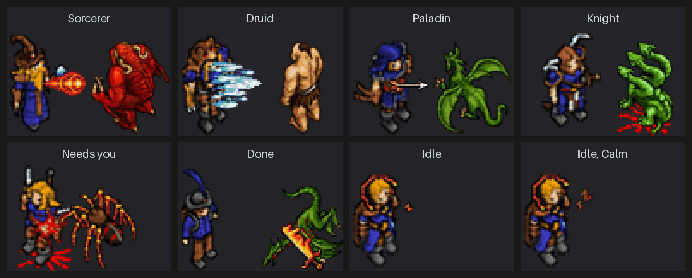

# Tibia Agents for Herdr

Herdr's Agents panel, with an animated Tibia scene for each agent status.



*Rendered from the panel's sprites, with its Full motion timing.*

| Status | Scene |
| --- | --- |
| Needs you | The monster closes in; blood on the character and the floor. |
| Done | The monster's corpse with a piece of loot on it. |
| Working | The character attacks a monster, in the way of its vocation. |
| Idle | The character dozes. |

Click the character in the panel header to choose:

- **Outfit:** 24 outfits and 7 retro (oldschool) ones, male or female.
- **Vocation:** how the character attacks while an agent works.
- **Motion:** how much the panel moves.

| Vocation | Working scene |
| --- | --- |
| Sorcerer (default) | Casts fire, energy, energy ball, or sudden death. |
| Druid | Casts ice, small ice, earth, or poison. |
| Paladin | A random shot each time: arrows, bolts, spears, throwing stars and knives, or holy spells. Draws blood. |
| Knight | Walks up to the monster, strikes it so it bleeds, and walks back. |

| Motion | Behavior |
| --- | --- |
| Calm (default) | 2.5 s between attacks; the sleeping and narrow-sidebar sprites hold still. |
| Full | 0.6 s between attacks; the Zzz rises and the narrow-sidebar sprite bobs. |
| Still | As Calm, and working scenes are frozen with nothing flying. |

The Needs you burst plays in all three, so it stands out.

The art is CipSoft's, taken from Tibia client files. Keep this repository
private, or remove `mods/agents-tibia/sprites/` **and its Git history** before
publishing it.

## Install or update

Needs Herdr (built against 0.1.18), started at least once, and `python3`. The
sprites are included. From this directory:

```sh
python3 install.py
herdr-app do layout.switch '{"name":"tibia"}'
```

The installer checks the mod, copies it to
`~/.config/herdr-app/mods/agents-tibia/`, and writes `layouts/tibia.json` from
your shipped `main` layout. It saves any mod and layout it replaces under
`~/.config/herdr-app/backups/`. Run it again after pulling changes or after a
Herdr upgrade.

`layouts/tibia.json` is rebuilt each time, so reapply any changes you made to
it. For another Herdr home, pass `--home`.

To go back: `herdr-app do layout.switch '{"name":"main"}'`.

## Customize

The male mage, Sorcerer, and Calm motion are the defaults. One choice applies to
every agent, and the vocation is independent of the outfit.

To offer other outfits, monsters, attacks, or loot, edit `outfits.js`,
`fights.js`, or `loot.js` in `mods/agents-tibia/`, regenerate the sprites, and
run the installer.

See [panel internals](docs/panel.md) for the sprite layers, previewing every
status with demo agents, platform notes, and Herdr upgrades.

## Regenerate the sprites

Needs Pillow, plus `Tibia.spr` and `Tibia.dat` of the extended 8.6 profile
(`cip860-extended`, from release `15.25.0a00a0` of
[tibia-client](https://github.com/dudantas/tibia-client/releases/latest)) in
`~/Documents/tibia-8.6/`:

```sh
python3 tools/dump-dat-860.py     # once per client version
python3 tools/tibia860.py         # writes mods/agents-tibia/sprites/
python3 install.py
```

For client files kept elsewhere, pass `--dat <path>/Tibia.dat` to the dump and
`--source <path>` to the generator. The generator also writes a contact sheet,
`preview-860.png`, beside the client files.

When changing the animations, keep `SPELL_STEPS`, `SLEEP_FRAMES`, and the hit
steps of `STRIKE_FRAMES` in `main.js` in line with the frames the generator
writes.
