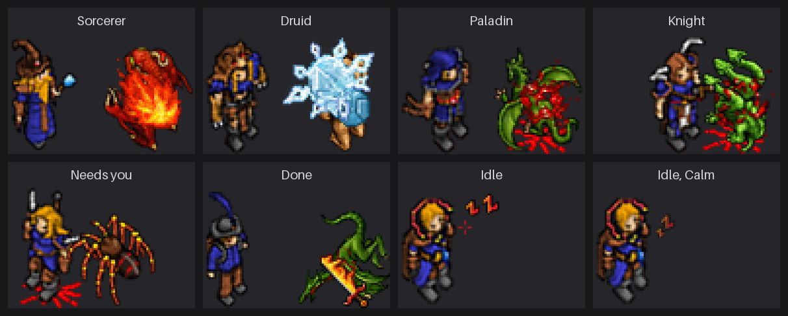

# Tibia Agents

Herdr's left sidebar Agents panel, where every agent status is a small Tibia
scene: your character fighting a monster while the agent works, cornered when it
needs you, standing over the loot when it is done, and dozing when it is idle.

## What you see

The `tibia` layout is the shipped `main` layout with only the Agents block
replaced by this mod. Colors and type come from the active theme.

- **Header** (41 px): "Agents" at 11.5 px, dim; at the right, the chosen
  character (30 px, the outfit picker button) and a 14 px sort icon.
- **Priority view:** sections in the order Needs you, Done, Working, Idle, after
  Pinned when something is pinned. A section header is 76 px high: the agent
  count (dim), the section name in its status color, then one 96×64 scene. Rows
  below are 30 px: program icon, space name, dimmed detail, machine name for a
  remote agent, and time since the last change (`<1m`, `5m`, `2h`, `3d`).
- **Grouped by space:** space headers (34 px); agent rows 70 px high with their
  own 96×64 scene at the right; sub-agents as a tree beneath their parent.
- **Rail** (sidebar narrower than 160 px; 44 px, 76 on macOS): 26 px rows with
  the agent number and a 20×20 sprite, and a `»` button at the bottom.

## How it behaves

| Status | Panel (96×64) | Rail (20×20) |
| --- | --- | --- |
| Working | A monster stands bottom-right, facing west; the character faces east. Sorcerer, druid, paladin: the character stands bottom-left, a missile flies in 5 frames and its hit effect shows in 4, 120 ms each, then 600 ms pause. With a paladin, blood also spurts from the monster during the hit, and a pool lies under it from the first hit until the working stretch ends (a panel reload clears it). Knight: blood lies under the monster. The character walks from 6 scene px right of its spot to 27 in 4 frames, alternating its two walking poses, stands while blood spurts from the monster in 4 frames, walks back in 3, 120 ms each, then pauses 600 ms at the start. | Character in its walking frame, bobbing 1 px every 240 ms. |
| Needs you (blocked) | The character faces south on a blood splatter, the monster right beside. A blood burst plays on the character: 6 frames, 85 ms each, then 320 ms pause. | Character with the burst. |
| Done | Still: the character as in Working, the monster's corpse where it stood, one loot item on the corpse. | Character beside the item. |
| Idle | The character as in Working with Zzz beside its head: 7 frames, 220 ms each, then 660 ms pause. | Character facing south, still. |

- The monster is picked when an agent starts working and stays through Needs you
  and Done. A sorcerer's or druid's attack is picked per working stretch from the
  vocation's list, a paladin's anew for every shot, the loot per completion.
  Picks are random, independent, and stable across redraws; a panel reload picks
  anew.
- 8 monsters (dragon, demon, cyclops, orc, giant spider, hydra, rotworm,
  skeleton) and 10 loot items (gold coins, violet gem, health potion,
  banana, fire sword, golden helmet, mastermind shield, backpack of holding,
  frozen starlight, thunder hammer).
- Attacks: Sorcerer (fire, energy, energy ball, sudden death), Druid (ice, small
  ice, earth, poison), and Paladin (arrow, poison, burst, sniper, onyx, flash,
  flaming, shiver, and earth arrows; bolt, power, infernal, and piercing bolts;
  spear, hunting, enchanted, royal, and ethereal spears; throwing, assassin, and
  viper stars; throwing knife; holy burst; small holy). A Knight always strikes
  up close, drawing blood. One vocation applies to every agent. It is chosen
  independently of the outfit; Sorcerer is the default.
- Motion is Calm (default), Full, or Still. The table above is Full. In Calm,
  attacks pause 2500 ms instead of 600, the Idle scene shows one still frame of the Zzz
  (phase 1 at 55% opacity), and the rail's working sprite does not bob. Still is
  Calm without the attacks: the Working scene holds with nothing flying (a
  Knight stands at the start). Needs you is the same in all three.
- Agents showing the same status animate in step. Burst, attack, and sleep
  animations stop when not drawn or when the window is hidden.
- A priority header shows the scene of the first agent listed in its section
  with that status, so priority rows have no scenes of their own.
- Click a row to focus its pane; click a sub-agent without a pane to peek at it.
- Hover a row to get a pin button; pinned agents come first.
- Click a header to fold its group. A row's chevron, or its program icon, folds
  its sub-agents.
- The sort icon opens a 200×140 popup: Priority or Grouped by space.
- The header character opens a 588×406 popup: a vocation toggle (Sorcerer,
  Druid, Paladin, Knight), which keeps the popup open, a Male/Female toggle, a
  grid of 24 outfits (8 columns, 72×76 cells, 52 px sprite and name), then a "Retro" label
  and one row of 7, the current outfit highlighted. It opens on the current sex.
  Clicking an outfit changes every scene and closes the popup. Outfits: Citizen,
  Hunter, Mage, Knight, Noble, Summoner, Warrior, Barbarian, Druid, Wizard,
  Oriental, Pirate, Assassin, Beggar, Shaman, Norse, Nightmare, Jester,
  Brotherhood, Demon Hunter, Yalaharian, Newly Wed, Warmaster, Wayfarer. Retro:
  the first seven in their oldschool looks, which have no addons. The male mage
  is the default. A last row sets the motion, Full, Calm, or Still, and keeps the
  popup open.
- A sub-agent without a pane counts `error` as blocked and `done` as idle.

## Built from

- One mod, `agents-tibia` (`main.js`, `outfits.js`, `loot.js`, `fights.js`,
  `sprites/`), a modified copy of the shipped `agents` mod of Herdr 0.1.18. Its
  `mod.json` has `"place": "none"`. The layout puts it in the block with id
  `agents`.
- Props: `{ sortMenu: true }` renders the sort popup, `{ outfitMenu: true }` the
  outfit picker; no props renders the panel.
- `herdr` functions: `agents`, `terminals`, `panes`, `focused`, `spaces`, `run`,
  `theme`, `shared`, `setShared`, `setAgentOrder`, `openOverlay`,
  `closeOverlay`, `props`, `window`, `layout`.
- Commands: `pane.focus`, `terminal.peek`, `terminal.pin`, `layout.resize`.
- State: shared `tibia.outfit`, `tibia.vocation`, `tibia.motion`,
  `agents.sort`, `sidebar.width`, `sidebar.collapsed`; `localStorage` `changed` (each agent's state, time, and
  fight) and `pins`.
- Icons come from the shipped `workspace-chrome` mod.
- Reaches no network, runs no programs, and reads no files outside Herdr's mods.
  `install.py` and `tools/` run outside Herdr; the installer runs
  `herdr-app check`.
- Art: PNGs made by `tools/tibia860.py` from the extended Tibia 8.6 client. Each
  scene is a stack of full-size transparent layers: character
  (`<outfit>/fight.png` or `<outfit>/cornered.png`), then `monsters/` and
  `spells/` (a paladin adds `blood/`; a knight: `blood/pool.png`, `monsters/`, the
  character or `<outfit>/step*.png`, then `blood/`), or
  `cornered/` and `melee/`, or `corpses/` and `rewards/`, or
  `sleep/`.
- Outfits are shaded gold hair `#FFAA00`, indigo top `#3F3FCC`, brown trousers
  `#B46337`, gray boots `#737373`, with every addon layer. A character is 1.25×
  its client art, or less to fit 44×62 px.

## Watch out

- The extended pack's outfit and monster sprites are stored rotated 45°; rotate
  them -45°. Sprite 0 of a frame is its bottom-right tile.
- Looktype 160 has no art in this pack.
- On macOS, images show thin edge lines. Draw the copies in `sprites/padded/`
  (3 px transparent border) clipped to size.
- Animate with one timer per animation that calls `notify`, and ask for a frame
  only when drawing it, so unused timers stop.
- Right after a reload, images can be blank until they load.
- `SPELL_STEPS`, `STRIKE_FRAMES`, and `SLEEP_FRAMES` in `main.js` must match the
  frames on disk.
- `install.py` expects the shipped `main` layout to have exactly one block with
  id `agents` showing the `agents` mod, and stops otherwise. Upstream changes to
  the shipped mod need merging into `main.js` by hand.

## Done when

- `herdr-app check mods/agents-tibia` passes.
- `python3 install.py` writes the mod and `layouts/tibia.json`, and
  `herdr-app status` shows no errors after switching to `tibia`.
- Agents reporting `working`, `blocked`, `done`, and `idle` (OSC 7501) show
  their four scenes in priority headers and in grouped rows.
- An agent going from working to blocked or done keeps its monster.
- Each vocation shows its own attack in the Working scene, and the choice
  survives a restart.
- Full, Calm, and Still behave as described above, and the choice survives a
  restart.
- Picking an outfit in the header popup changes the character in every scene, and
  the choice survives a restart.
- The rail shows the 20 px sprites.
